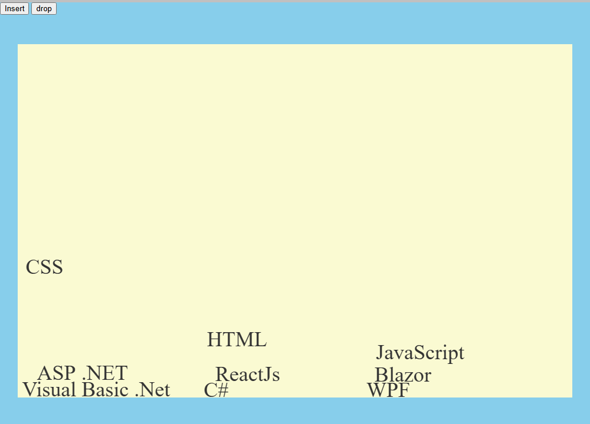

# Gravity

A small canvas toy: the names of the technologies I work with fall, bounce, stack and
can be thrown around with the mouse or a finger. Plain HTML, CSS and JavaScript, no
libraries.

**Try it:** https://mohammad-diab.github.io/Gravity/

## How to play

- **Insert** places the names at their starting positions (no gravity). Drag them around.
- **drop** restarts the scene and lets gravity pull everything down.
- Grab any name and throw it: names collide with each other and with the edges, bounce,
  and come to rest.

## Run it locally

Open `index.htm` in a browser. Nothing to install or build.

## License

[MIT](LICENSE)
